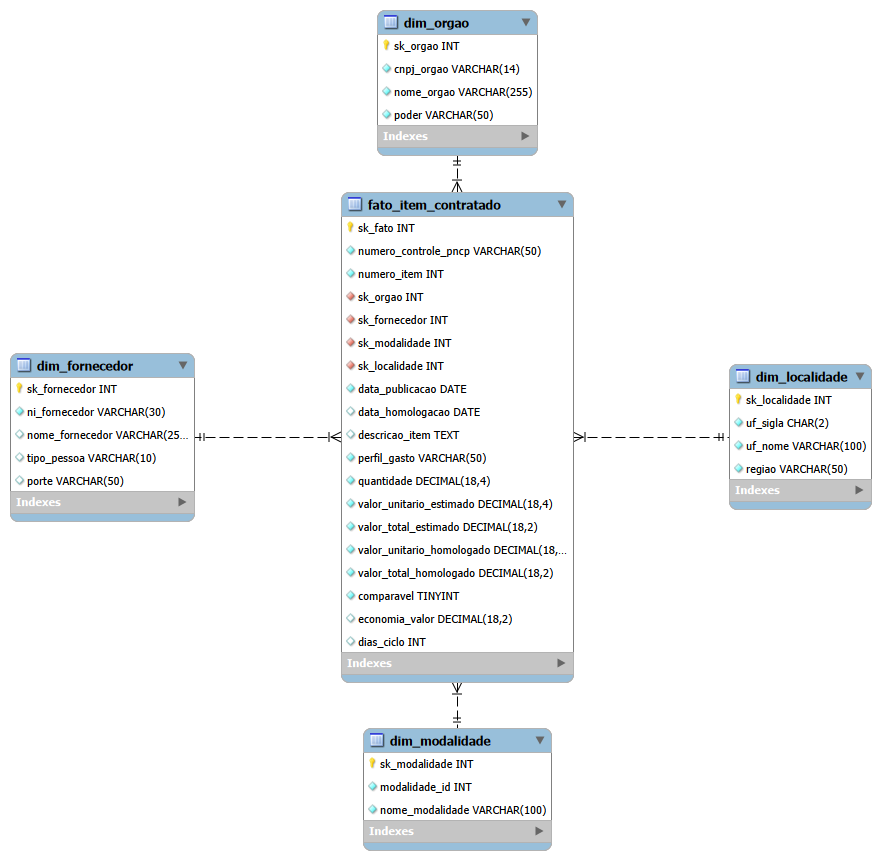
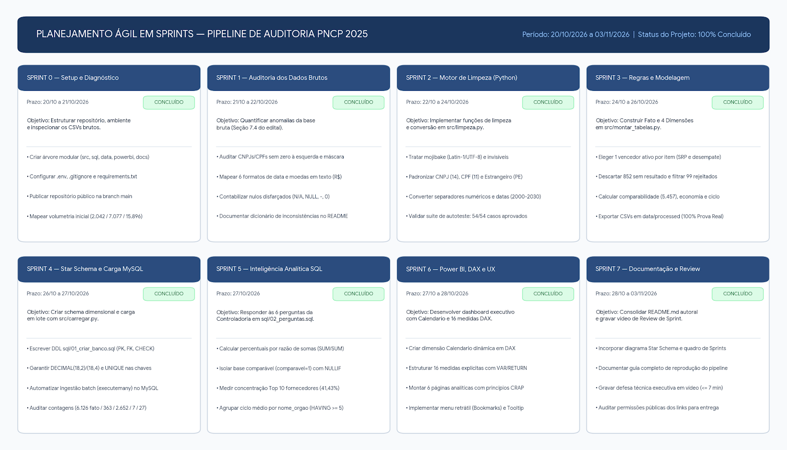

# Auditoria e Controle de Contratações Públicas (PNCP 2025)

Pipeline analítico **End-to-End** (**Python + MySQL + Power BI**) desenvolvido para saneamento, modelagem dimensional (*Star Schema*) e auditoria das contratações públicas federais extraídas do Portal Nacional de Contratações Públicas (PNCP) referentes ao ano de 2025.

> 🎥 **Apresentação Executiva e Defesa Técnica (Review de Sprint em Vídeo):**
> **https://drive.google.com/file/d/1OR0VDbuqR2OQX17MOS0KGx8ZfOiWgWty/view?usp=sharing**

---

## 1. Contextualização e Arquitetura da Solução

A Controladoria identificou gargalos operacionais severos nas compras e contratações públicas federais de 2025: indícios de sobrepreço em itens homologados, forte concentração orçamentária em poucos fornecedores, morosidade entre a publicação de editais e a homologação dos certames e baixa competitividade em determinadas modalidades.

Como os sistemas legados não possuem validação rígida na ponta, o repositório bruto (`data/raw/`) apresentava múltiplas anomalias estruturais. Este projeto implementa uma esteira analítica automatizada e auditável que higieniza os dados brutos em Python, estrutura um Data Warehouse em **Star Schema** no MySQL e disponibiliza um painel executivo no Power BI para resposta às 6 perguntas estratégicas de negócio.

### Tecnologias Utilizadas e Estrutura de Diretórios
* **ETL e Saneamento**: Python 3.10+ (`pandas`, `pathlib`, `re`, `datetime`)
* **Banco de Dados Dimensional**: MySQL 8.0 (`mysql-connector-python`, MySQL Workbench)
* **Visualização e DAX**: Microsoft Power BI Desktop (`VAR`/`RETURN`, `CALCULATE`, `DIVIDE`, `RANKX`, `TOPN`, `SUMX`, `AVERAGEX`, `USERELATIONSHIP`)
* **Versionamento e Gestão**: Git, GitHub Desktop e planejamento ágil em Sprints

```text
├── data/
│   ├── raw/                  # Arquivos CSV brutos do PNCP 2025 (compras, itens, resultados)
│   └── processed/            # Tabelas Fato e Dimensões limpas geradas pelo pipeline Python
├── docs/
│   └── img/
│       ├── sprints.png       # Quadro visual do planejamento e execução em Sprints
│       └── star_schema.png   # Diagrama relacional do modelo Star Schema no MySQL
├── powerbi/
│   └── dashboard_controladoria_pncp.pbix  # Dashboard executivo, modelo estrela e medidas DAX
├── reports/                  # Diretório reservado para relatórios auxiliares
├── sql/
│   ├── 01_criar_banco.sql    # Script DDL de criação do Star Schema e constraints no MySQL
│   └── 02_perguntas.sql      # Consultas SQL que respondem às 6 perguntas da Controladoria
├── src/
│   ├── __init__.py
│   ├── config.py             # Mapeamento de diretórios e leitura segura de variáveis do .env
│   ├── limpeza.py            # Funções puras de saneamento, conversão e suíte de autoteste (54/54)
│   ├── montar_tabelas.py     # Aplicação das 12 regras de negócio e geração do Star Schema
│   ├── banco.py              # Camada de conexão MySQL e inserção transacional em lote (batch)
│   └── carregar.py           # Orquestrador de criação do banco, carga em lote e conferência
├── .gitignore                # Proteção de credenciais (.env) e arquivos temporários
├── requirements.txt          # Dependências do ambiente Python
└── README.md                 # Documentação técnica e guia de reprodução
```

---

## 2. Diagnóstico e Auditoria dos Dados Brutos (Seção 7.4)

### 2.1. Volumetria e Unicidade de Chaves
- **`compras.csv`**: **2.042 linhas** e **2.042** valores únicos de `numero_controle_pncp` (0 duplicados).
- **`itens.csv`**: **7.077 linhas** e **0 duplicados** na chave composta (`numero_controle_pncp` + `numero_item`).
- **`resultados.csv`**: **15.896 linhas** (múltiplos fornecedores classificados por item, especialmente em certames com Sistema de Registro de Preços — SRP).

### 2.2. Dicionário de Anomalias Identificadas na Base Bruta

| Categoria de Anomalia | Arquivo / Coluna Afetada | Ocorrências | Descrição do Problema e Tratamento Aplicado |
| :--- | :--- | :---: | :--- |
| **Documentos (CNPJ/CPF)** | `compras.cnpj_orgao` | 381 | 176 com máscara (`./-`), 131 com espaços invisíveis (`\xa0`) e 74 com perda de zero à esquerda (12 ou 13 dígitos). Padronizado com `.zfill(14)`. |
| **Documentos (CNPJ/CPF/PE)** | `resultados.ni_fornecedor` | 2.976 | Mistura `PJ` (11.344), `PF` (4.531) e `PE` (21 estrangeiros). 1.633 com máscara, 990 com `\xa0`, 194 PJs e 159 PFs sem zero à esquerda. |
| **Moedas e Separadores** | `compras`, `itens` e `resultados` | 15.643 | Uso de `R$`, espaços invisíveis (`\xa0`), mistura de padrão BR (`1.234,56`) e US (`1,234.56`), além de quantidades formatadas como moeda (`R$ 24,00`). |
| **Formatos de Data** | `data_publicacao` / `data_resultado` | 17.938 | Convivência de 6 máscaras distintas (`YYYY-MM-DD`, `DD/MM/YYYY`, `DD-MM-YYYY`, `DD.MM.YYYY`, `YYYY/MM/DD` e `YYYYMMDD`), com e sem hora. |
| **Violação Cronológica** | `resultados.data_resultado` | 234 (bruto) / **230 (fato)** | Data de homologação anterior à data de publicação do edital (`data_resultado < data_publicacao`). Tratamento: anulação da data e do ciclo, mantendo o item na fato. |
| **Encoding (`Mojibake`)** | `objeto_compra`, `municipio`, `nome_unidade`, `descricao`, `nome_fornecedor` | 202 | Textos UTF-8 lidos como Latin-1 (ex.: `Aquisição`). Revertidos via `.encode("latin-1").decode("utf-8")`. |
| **Despadronização de Órgãos** | `compras.razao_social_orgao` | 67 CNPJs | 440 grafias brutas para 363 CNPJs (variações de caixa e espaços). Após padronização em maiúsculas, consolidam-se em 352 nomes únicos. |

### 2.3. Mapeamento de Nulos Disfarçados e Vazios
O caractere `"0"` foi tratado como nulo apenas em colunas de texto (`zero_eh_nulo=True`), sendo preservado como número válido (`0.0`) em quantidades e valores monetários (`zero_eh_nulo=False`):
- **`compras.processo`**: 77 nulos disfarçados (`NULL`: 18, `-`: 16, `N/A`: 16, `0`: 12, `SEM INFORMAÇÃO`: 10, `NÃO INFORMADO`: 5).
- **`compras.modo_disputa`**: 967 nulos disfarçados (`NÃO SE APLICA`: 904, `N/A`: 20, `NULL`: 15, `NÃO INFORMADO`: 9, `0`: 7, `SEM INFORMAÇÃO`: 6, `-`: 6).
- **`itens.categoria_item`**: 7.077 ocorrências de `NÃO SE APLICA` (100% da coluna).
- **`itens.situacao_item`**: 220 nulos disfarçados (`N/A`: 67, `NULL`: 44, `SEM INFORMAÇÃO`: 31, `-`: 29, `0`: 25, `NÃO INFORMADO`: 24).
- **`itens.criterio_julgamento`**: 1.883 ocorrências de `NÃO SE APLICA`.
- **`resultados.porte`**: 4.893 nulos disfarçados (`NÃO INFORMADO`: 4.468, `N/A`: 132, `NULL`: 115, `SEM INFORMAÇÃO`: 60, `0`: 57, `-`: 52, `NÃO SE APLICA`: 9).

### 2.4. Descarte sem Resultado (Regra 3) e Itens Rejeitados (Regra 4)
- **Itens sem resultado homologado ativo (Regra 3)**: **852 itens** (dos 7.077 totais) não possuem resultado ou possuem apenas resultados cancelados (`data_cancelamento` preenchida em 62 registros). Avaliados pela Regra 4: **6.225 itens**.
- **Itens rejeitados por inconsistência de negócio (Regra 4)**: **99 itens** barrados antes da carga na tabela fato (restando **6.126 itens válidos**). Contagem pelo 1º motivo de rejeição:
  1. Valor total estimado < R$ 1,00: **59 itens**
  2. Valor unitário estimado ausente ou <= 0: **23 itens**
  3. Valor total homologado > 1.000x o estimado: **7 itens**
  4. Valor unitário homologado ausente ou <= 0: **6 itens**
  5. Valor total (estimado ou homologado) > R$ 1 trilhão (1e12): **3 itens**
  6. Quantidade vazia ou <= 0: **1 item**

---

## 3. Modelagem Dimensional (Star Schema)



A tabela fato `fato_item_contratado` (6.126 linhas, uma por item contratado) relaciona-se com quatro dimensões no MySQL por chaves substitutas (`sk_*`), além da dimensão `Calendario` construída dinamicamente em DAX no Power BI. Todas as relações são do tipo 1:N (1 dimensão : N itens).

| Tabela | Tipo | Linhas | Chave Primária (SK) | Chave Natural (`UNIQUE`) |
| :--- | :---: | :---: | :--- | :--- |
| `fato_item_contratado` | Fato | 6.126 | `sk_fato` | `numero_controle_pncp` + `numero_item` |
| `dim_orgao` | Dimensão | 363 | `sk_orgao` | `cnpj_orgao` |
| `dim_fornecedor` | Dimensão | 2.652 | `sk_fornecedor` | `ni_fornecedor` |
| `dim_modalidade` | Dimensão | 7 | `sk_modalidade` | `modalidade_id` |
| `dim_localidade` | Dimensão | 27 | `sk_localidade` | `uf_sigla` |

O script DDL `sql/01_criar_banco.sql` remove as tabelas existentes na ordem inversa das dependências (fato primeiro, depois as dimensões) antes de recriá-las, garantindo idempotência para repetir a carga sem intervenção manual.

---

## 4. Decisões Técnicas de Modelagem e Regras de Negócio

### 4.1. Regra de integridade `chk_fato_valores` e itens com valor simbólico

A tabela `fato_item_contratado` possui uma restrição `CHECK` (`chk_fato_valores`) que atua como segunda barreira de integridade no banco de dados (Seção 4.3 do edital: *"a fato não aceita quantidade <= 0 nem valores negativos"*):

- `valor_unitario_estimado > 0`
- `valor_total_estimado >= 1`
- `valor_unitario_homologado > 0`
- `valor_total_homologado >= 0`

Na primeira tentativa de carga com a condição estrita `valor_total_homologado > 0`, o MySQL rejeitou o lote com o erro 3819 (`Check constraint 'chk_fato_valores' is violated`). Uma auditoria sobre a base processada demonstrou que apenas **3 dos 6.126 itens** apresentavam `valor_total_homologado = 0.00`:

| `numero_controle_pncp` | Valor total estimado | Valor unit. homologado | Quantidade | Valor total homologado |
| :--- | :---: | :---: | :---: | :---: |
| `00394452000103-1-009745/2025` | R$ 10.000,00 | R$ 0,0001 | 1,0000 | R$ 0,00 |
| `00394502000144-1-004219/2025` | R$ 745.000,00 | R$ 0,0001 | 1,0000 | R$ 0,00 |
| `00394452000103-1-019179/2025` | R$ 100,00 | R$ 0,0001 | 1,0000 | R$ 0,00 |

- **Causa:** São itens homologados com valor unitário simbólico de `R$ 0,0001` (comum em licitações de taxa administrativa ou centavo simbólico, armazenado corretamente em `DECIMAL(18,4)`). Como o valor total é arredondado para 2 casas decimais (`DECIMAL(18,2)`), o produto `0,0001 × 1` resulta em `0,00`.
- **Decisão Técnica:** A restrição no banco foi ajustada para `valor_total_homologado >= 0` (barrando valores negativos enquanto preserva `valor_unitario_homologado > 0`), mantendo os 3 registros que compõem o universo oficial de **6.126 itens** da Prova Real.
- **Proteção Automática nos Indicadores de Economia (Regra 6):** Esses 3 itens **não** distorcem nem inflam o cálculo de economia do projeto. Pela Regra 6 implementada em `src/montar_tabelas.py`, um item só é marcado como comparável (`comparavel = 1`) quando a razão `valor_total_homologado / valor_total_estimado` situa-se entre `0,1` e `10`. Como nesses 3 casos a razão é `0,00` (`< 0,1`), o pipeline atribui automaticamente `comparavel = 0` e `economia_valor = 0,00`, isolando-os das métricas de deságio.

### 4.2. Outras Decisões Críticas do Pipeline
- **Desempate de Vencedores em SRP e Credenciamento (Regra 2):** Descarte prévio de resultados cancelados (`data_cancelamento != ""`) antes da seleção do 1º colocado (`ordem_classificacao_srp`, onde vazio equivale a `1`), promovendo o 2º colocado quando o 1º foi cancelado e desempatando pelo menor `sequencial_resultado` numérico.
- **Prioridade na Classificação do Perfil de Gasto (Regra 8):** Aplicação da expressão regular `\b(?:OBRAS?|CONSTRUÇÃO|CONSTRUCAO|REFORMA|ENGENHARIA)\b` sobre `descricao_item` + `objeto_compra` com precedência sobre a coluna `material_ou_servico` (`Bens` e `Serviços`).

---

## 5. Planejamento e Gestão em Sprints

O projeto foi organizado e executado em 8 Sprints com validação dos entregáveis frente à Prova Real (Anexo 8):



---

## 6. Síntese dos Resultados Analíticos (SQL e Power BI)

- **P1 — Economia Global do Poder Público:** Volume homologado total de **R$ 8.044.498.805,74** (6.126 itens em 1.962 contratações). Na base comparável (**5.457 itens** / **89,08%** da base, com estimado de **R$ 6.867.663.469,91**), a economia nominal atingiu **R$ 992.861.686,95** (**14,46%** de economia), com **27 itens** apresentando sobrepreço.
- **P2 — Concentração e Risco de Fornecedores:** Dos **2.652 fornecedores**, apenas os **10 maiores** absorvem **41,43%** de todo o orçamento homologado (**R$ 3.332.484.029,86**), liderados por *Now Seguros SA* (R$ 1,06 bi / 13,18%).
- **P3 — Eficácia por Modalidade:** A **Concorrência Eletrônica** concentra **58,43%** do volume financeiro (R$ 4,70 bi; 14,27% de economia), enquanto o **Pregão Eletrônico** lidera o deságio com **24,02%** de economia (**+9,6 p.p.** acima da média geral). O **Credenciamento** (26,62% do volume) não possui itens comparáveis por operar com teto global.
- **P4 — Tempo do Ciclo de Compras:** Ciclo médio de **48,1 dias** e máximo de **611 dias** nos **5.896 itens com ciclo válido** (**230 itens** tiveram a homologação anulada por violação cronológica). Entre os 142 órgãos com 5+ itens com ciclo, lideram em morosidade a *UFCG* (**266,3 dias**), o *CONFEA* (**223,0 dias**) e o *DNIT* (**156,2 dias**).
- **P5 — Distribuição Regional:** Em **363 unidades compradoras** (CNPJs distintos), o **Centro-Oeste** concentra **44,25%** do gasto (R$ 3,56 bi, puxado pelo **DF** com **38,98%**). A **Região Norte** lidera o desconto percentual (**21,43%**), destacando-se por UF o **AC (26,71%)**, **MT (25,84%)** e **BA (25,01%)**.
- **P6 — Perfil dos Gastos:** **Obras e Engenharia** concentram **60,8%** do orçamento (967 itens; **R$ 4,89 bilhões**; ticket médio de **R$ 5,06 milhões**), seguidos por **Serviços** com **36,6%** (1.849 itens; R$ 2,94 bi) e **Bens** com **2,6%** (3.310 itens; R$ 211,19 mi).

---

## 7. Guia de Execução e Reprodução do Pipeline

### 7.1. Pré-requisitos
- Python 3.10+, Servidor MySQL 8.0 em execução e Power BI Desktop.
- Arquivo `.env` criado na raiz do projeto com as credenciais locais do MySQL:

```ini
MYSQL_HOST=localhost
MYSQL_PORT=3306
MYSQL_USER=root
MYSQL_PASSWORD=sua_senha_aqui
MYSQL_DATABASE=pncp_controladoria
```

- Instalação das dependências Python:

```powershell
python -m pip install -r requirements.txt
```

### 7.2. Execução Passo a Passo

1. **Autoteste das funções de higienização (`src/limpeza.py`)**:
   ```powershell
   python -m src.limpeza
   ```
   *(Retorno esperado: `54 de 54 exemplos certos ✔ tudo certo, pode ir para a proxima etapa!`).*

2. **Transformação, aplicação das regras de negócio e geração dos CSVs (`src/montar_tabelas.py`)**:
   ```powershell
   python -m src.montar_tabelas
   ```
   *(Gera os 5 arquivos em `data/processed/` e exibe a conferência completa com o Anexo 8).*

3. **Criação do Star Schema e carga em lote no MySQL (`src/carregar.py`)**:
   ```powershell
   python -m src.carregar
   ```
   *(Executa `sql/01_criar_banco.sql`, carrega as 4 dimensões, carrega a tabela fato e valida as contagens).*

### 7.3. Conferência Esperada da Carga

```text
Carga:
   dim_orgao: 363 linhas
   dim_fornecedor: 2652 linhas
   dim_modalidade: 7 linhas
   dim_localidade: 27 linhas
   fato_item_contratado: 6126 linhas
Conferencia:
   fato_item_contratado: 6126 (esperado 6126) -> OK
   dim_orgao: 363 (esperado 363) -> OK
   dim_fornecedor: 2652 (esperado 2652) -> OK
   dim_modalidade: 7 (esperado 7) -> OK
   dim_localidade: 27 (esperado 27) -> OK
```

4. **Auditoria SQL e Visualização no Power BI**:
   - Execute o script `sql/02_perguntas.sql` no MySQL Workbench para auditar as consultas das 6 perguntas.
   - Abra o relatório `powerbi/dashboard_controladoria_pncp.pbix` no Power BI Desktop.

---

## 8. Melhorias Futuras

- **Extração Automatizada via API REST do PNCP**: Substituir a ingestão de CSVs estáticos por consumo incremental agendado diretamente dos endpoints oficiais (`https://pncp.gov.br/api/consulta/`).
- **Detecção Estatística de Sobrepreço por Catálogo (CATMAT/CATSER)**: Aplicar modelos de detecção de anomalias (*Z-Score* robusto / *Isolation Forest*) comparando preços unitários de itens equivalentes entre diferentes regiões.
- **Cruzamento Societário (QSA da Receita Federal)**: Integrar a base pública de sócios ao CNPJ dos fornecedores (`dim_fornecedor`) para auditar conluio ou concentração econômica em grupos empresariais do mesmo quadro societário.